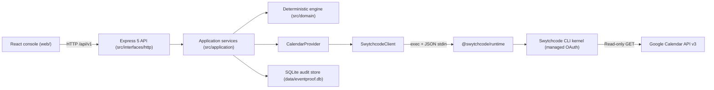

# EventProof — Proof Before Post

EventProof verifies campus event announcements against authoritative calendar records **before** organizers publish them. It fetches the official event through [Swytchcode](https://swytchcode.com), compares it field-by-field against an announcement draft with a deterministic engine, and returns an evidence-backed `VERIFIED` / `REVIEW_REQUIRED` / `UNVERIFIABLE` decision with exact corrections. EventProof never publishes anything — the organizer always approves and posts.

## Why verify before sharing?

Campus announcements circulate across WhatsApp, Instagram, posters, and websites. Dates change without updated posters, venues move after drafts are written, different channels show different times, and multiple versions of "the truth" confuse students and organizers alike. Manual cross-checking is slow and misses exactly the small discrepancies — a wrong date, a moved venue — that cause the most damage: wasted trips, missed events, and embarrassing re-announcements.

EventProof inserts a fast, repeatable, explainable check between event information and publication. Every verification fetches the live official record at check time, so outdated copies are caught instead of circulated, and one source-backed set of corrected details can be pasted into every channel.

**Intended users:** college event organizers, student clubs, university administrators, and campus communities.

## How EventProof Works

1. **Fetch official events from Google Calendar.** The backend lists authoritative events through Swytchcode's read-only calendar tools.
2. **Select an event.** Search the calendar (query + date range + pagination) or look up one record by its exact event ID; the selection carries the exact Google event ID into verification.
3. **Enter announcement details.** Fill in the draft exactly as planned for publication: title, date, times, time zone, venue, registration URL.
4. **Compare announcement details against the official event.** `POST /api/v1/verifications` re-fetches the official record by exact ID and runs the deterministic comparison — no window, no guessing.
5. **Show verification results and correction suggestions.** A decision plus a field-by-field evidence table; every mismatch with an authoritative value yields an exact correction that can be previewed, applied to the draft, or copied.
6. **Store verification records in history.** The full result — status, field evidence, source reference, timestamps, request ID — persists in SQLite and survives restarts.

## Key Features

| Feature | What it does |
|---|---|
| Overview Dashboard | Real statistics (total, verified, review-required, unverifiable), recent activity, open mismatches needing attention, and a live integration summary. Genuine zeros render as `0`; failures render as errors, never as `0`. |
| Google Calendar event fetching | Live search (free-text query, date range, pagination) and direct lookup by event ID, served from the connected calendar through Swytchcode. |
| Event selection | Select a listed record or fetch one by ID, then verify against it — the exact source event ID flows into the verification request. |
| Announcement verification | Three-step workspace: load the official record → enter the draft → submit. Inline validation, double-submit prevention, and draft preservation across failures. |
| Field-by-field comparison | Side-by-side official vs. draft table with Critical markers, state badges (icon + text), human-readable explanations, and source-derived corrections. |
| Correction Assistant | Deterministic fixes from the official record only: corrected preview, apply-to-draft, copy-to-clipboard with fallback, plus a "needs manual confirmation" list for unverifiable fields. |
| Verification History | Durable audit trail with status filter, text search, date range, pagination, and full detail replay of any record. |
| Integrations and Settings | Safe Swytchcode/CLI/auth/fetch diagnostics (no tokens shown) and local preferences: API base override plus explicit demo-mode toggle. |
| Demo mode | Clearly labeled synthetic fixtures for exploring the UI without a backend. Demo data is never sent anywhere and never mixed into real history or statistics. |

## Technology Stack

### Frontend (`web/`)

| Technology | Version | Role |
|---|---|---|
| React + React DOM | 19.3.1 | UI components and rendering |
| React Router | 7.18.5 | Client-side routing (overview, events, verify, history, integrations, settings) |
| Tailwind CSS (+ Vite plugin) | 4.3.4 | Utility-first styling |
| Lucide React | 1.69.0 | Icon set |
| Vite (+ React plugin) | 8.3.6 / 6.2.1 | Dev server, HMR, production bundler |

### Backend (repo root)

| Technology | Version | Role |
|---|---|---|
| Node.js | ≥ 22 (observed v22.18.0) | Runtime |
| Express | 5.3.0 | HTTP API (`/api/v1`, 8 endpoints) |
| `@swytchcode/runtime` | 1.2.1 | SDK `exec()` used by the Swytchcode client |
| zod | 4.6.7 | Pinned dependency (the SDK loads it unconditionally) |

### Database

| Technology | Role |
|---|---|
| SQLite via built-in `node:sqlite` (`DatabaseSync`) | Durable audit store at `data/eventproof.db` (WAL mode, versioned migrations, indexed queries); an in-memory repository exists for tests only |

### Integration

| Technology | Version | Role |
|---|---|---|
| Swytchcode CLI (`swytchcode` / `swy` alias) | 2.25.5 | Tool discovery, managed OAuth, execution kernel |
| Google Calendar API v3 via Swytchcode | provider library `calendar` v3 | Authoritative event source, read-only (`calendar.event.get`, `calendar.event.get1`) |

### Development and testing tools

| Tool | Version | Role |
|---|---|---|
| `node:test` + `node:assert/strict` | Node built-in | Backend unit/integration/contract tests |
| light-my-request | 6.8.0 | In-process HTTP injection for API tests (no sockets) |
| Vitest + Testing Library + User Event + jsdom | 5.1.0 / 16.3.3 / 14.6.8 / 26.x | Frontend component, API-client, and journey tests |
| `scripts/check.js` | — | Zero-dependency syntax gate (`node --check` over first-party files) |
| `scripts/swytchcode-smoke.js` | — | Real-CLI smoke test (offline checks + gated live execution) |
| GitHub Actions (`.github/workflows/ci.yml`) | — | Backend check + tests + offline smoke; frontend tests + build |

No AI APIs, paid services, message queues, caches, containers, or microservices are used.

## Architecture Overview



Dependency rule: **domain and application never import infrastructure.** The Swytchcode SDK is referenced only by `swytchcode.client.js`; swapping the provider means implementing the `EventSourceProvider` port — engine, services, and routes stay untouched.

## Frontend Architecture

React 19 single-page console built with Vite, styled with Tailwind, routed with React Router 7.

**Pages** (`web/src/features/`, wired in `web/src/app/routes.jsx`, shelled by `web/src/app/App.jsx`):

| Route | Page | Purpose |
|---|---|---|
| `/` | `dashboard/DashboardPage.jsx` | Statistics, recent activity, discrepancies, integration summary |
| `/events` | `events/EventsPage.jsx` | Calendar search + pagination, lookup by event ID, event selection |
| `/verify` | `verification/VerifyPage.jsx` | Three-step workspace: official record → draft form → submit |
| `/verify` (result) | `verification/ResultView.jsx` | Decision summary, comparison table, Correction Assistant, evidence panel |
| `/history` | `history/HistoryPage.jsx` | Filterable, paginated audit trail |
| `/history/:verificationId` | `history/HistoryDetailPage.jsx` | Verbatim replay of one audit record |
| `/integrations` | `integrations/StatusPage.jsx` | CLI / runtime / auth / fetch diagnostics |
| `/settings` | `settings/SettingsPage.jsx` | API base override, demo-mode toggle, about |
| `*` | `misc/NotFoundPage.jsx` | Unknown routes |

**How it talks to the backend:** `web/src/lib/api-client.js` is the only module that calls `fetch()`. It owns base-URL resolution (Settings override → `VITE_API_BASE_URL` → same origin), 30 s timeout + abort, envelope parsing, error normalization per backend code, and request-ID propagation. Typed wrappers (`health`, `listEvents`, `getEvent`, `createVerification`, `getVerification`, `listVerifications`, `verificationStats`, `integrationStatus`) hit `/api/v1/*`; in dev, `vite.config.js` proxies `/api` to the backend (`EVENTPROOF_BACKEND`, default `http://127.0.0.1:3000`). `web/src/hooks/use-api.js` manages request state (idle/loading/success/error, stale-guard); `web/src/app/providers.jsx` provides toast notifications and the global demo flag; `web/src/lib/format.js` renders values only — verification decisions always come from the backend.

**Responsive UI and workflow:** desktop sidebar navigation collapses to a mobile top bar with a menu; content is constrained to a readable max width; comparison rows stack on narrow screens. The core workflow is Events → Verify (deep-linked via `?eventId=`) → result with corrections → History for the durable record.

## Backend Architecture

Node.js + Express 5 API organized in layers (`src/`):

```text
src/config                 env validation (env.js) + app constants (application.js)
src/domain                 text/time utils, event + draft models, verification engine
src/application            services + ports (provider/audit boundaries)
src/infrastructure         swytchcode client, calendar provider, audit store
src/interfaces/http        app factory, server, routes, controllers, middleware
src/shared                 error taxonomy, redacting JSON logger
```

**Routes, controllers, services.** `interfaces/http/routes/v1.js` mounts 8 endpoints under `/api/v1`, handled by thin controllers (`controllers/events.controller.js`, `verifications.controller.js`, `health.controller.js`, `integrations.controller.js`, plus `respond.js` envelope helpers). Controllers forward to application services — no validation in controllers, one validation site per concern:

| Method | Endpoint | Service | Purpose |
|---|---|---|---|
| GET | `/api/v1/health` | — (local state) | Liveness; performs no upstream calls |
| GET | `/api/v1/events?timeMin&timeMax&query&limit&pageToken` | `FetchEventsService` | List official events |
| GET | `/api/v1/events/:eventId` | `FetchEventsService` | One event by exact ID (cancelled shown, not filtered) |
| POST | `/api/v1/verifications` | `VerifyAnnouncementService` | Verify a draft → 201 + `Location` |
| GET | `/api/v1/verifications` | `HistoryService` | Paginated history (`status/q/from/to/page/pageSize/sort`) |
| GET | `/api/v1/verifications/stats` | `HistoryService` | Genuine aggregates for the dashboard |
| GET | `/api/v1/verifications/:verificationId` | `HistoryService` | Replay one audit record verbatim |
| GET | `/api/v1/integrations/status` | `IntegrationService` | Safe diagnostics (CLI, runtime, auth, fetch telemetry) |

```jsonc
// POST /api/v1/verifications
{ "eventId": "abc123", "announcement": {
  "title": "Hacknite 2026", "eventDate": "2026-08-07",
  "startTime": "10:00", "endTime": "18:00",
  "timeZone": "Asia/Kolkata", "venue": "SVSU Campus" } }
// → { status: "VERIFIED" | "REVIEW_REQUIRED" | "UNVERIFIABLE",
//     summary, fieldResults: [{ field, official, draft, state,
//     explanation, correction, critical }] }
```

Contract details: [`docs/api-reference.md`](docs/api-reference.md).

**Deterministic verification engine** (`domain/verification/engine.js`, `comparison.js`, `result.js`). Pure functions with no I/O, clock, or network: field comparators normalize and compare seven fields, `decideStatus` applies precedence rules, and `buildVerificationResult` stamps a validated, serializable contract. See [Verification Logic](#verification-logic).

**Input validation and error handling.** Drafts are validated by `validateAnnouncementDraft` (400 structural / 422 semantic, before any fetch); event/calendar IDs, ranges, limits, and history filters are validated in the services. Every expected failure is an `ApplicationError` (`shared/errors/`) carrying `{code, message, details?}`; the error middleware is the single translator to `{success:false, error:{code,message,requestId}}` + status. Middleware chain (`interfaces/http/middleware/`): request ID → security headers → CORS allowlist → JSON parsing (256 KB cap) → per-process rate limiting → routes → 404 → centralized errors. `server.js` is the composition root: validates config, wires dependencies, binds `HOST`/`PORT` (default `127.0.0.1:3000`), bounds each request at 60 s, and drains gracefully on shutdown.

**SQLite-based persistent audit history** (`infrastructure/repositories/sqlite*.js`). One `node:sqlite` handle at `AUDIT_DB_PATH` (default `data/eventproof.db`), WAL mode, idempotent migrations tracked by `PRAGMA user_version`; tables `verifications` (full field evidence + source reference + request ID, indexed by status/time/source event) and `provider_fetch_log` (fetch telemetry). If storage fails, verification answers `AUDIT_STORAGE_UNAVAILABLE` (503) — a result is never returned without its durable record. Single-instance only; multi-instance production needs a managed database behind the same `AuditRepository` port.

**How official event data flows through the backend:**

```text
Controller → FetchEventsService / VerifyAnnouncementService
  → CalendarProvider (validates response shape, normalizes to OfficialEvent)
    → SwytchcodeClient (tool-id validation, stdin params, 15 s timeout,
       demo-payload refusal, exit-code mapping, bounded retries)
      → @swytchcode/runtime exec() → swytchcode CLI kernel → Google Calendar
```

## Swytchcode Integration

### What Swytchcode does in EventProof

Swytchcode is EventProof's **only path to Google Calendar**. The backend never holds OAuth tokens and never calls Google directly: it invokes two read-only calendar tools through the Swytchcode runtime, which injects the stored credentials, performs the HTTPS request against `https://www.googleapis.com/calendar/v3`, and returns structured JSON. `SwytchcodeClient` (`src/infrastructure/swytchcode/swytchcode.client.js`) is the only module allowed to invoke Swytchcode — tool IDs come from the app's own config, values travel via stdin (user input never becomes a shell argument), every call has an explicit timeout, simulated/demo payloads are refused as `SWYTCHCODE_SIMULATED_DATA`, and retries (≤ `SWYTCHCODE_MAX_ATTEMPTS`, exponential backoff + jitter) apply to transient failures only. Auth, policy, validation, and not-found failures never retry.

### Why Swytchcode was selected

The integration catalog (373 providers, fetched live during discovery) confirms Google Calendar as a first-class supported provider (library `calendar`, v3); campus organizers already keep authoritative event data there; and its read API cleanly separates listing from single-event retrieval. No alternative integration was needed, so none was selected — and the `EventSourceProvider` port keeps the door open if one ever is.

### Managed OAuth authentication

Authorization is completed in the browser via `swytchcode login` (device flow; session in `~/.swytchcode/auth.json`) plus `swytchcode auth connect google_calendar` (provider OAuth). Tokens live only in Swytchcode's own store — the app never requests, receives, stores, or logs credentials, and `auth status` is the read-only way to confirm state.

### CLI workflow: discover, inspect, download, enable

With the repo-local CLI (`tools/cli`, own lockfile; behavior identical to a global install):

| Step | Command | Purpose |
|---|---|---|
| Authenticate | `swytchcode login` | Device-flow login |
| Find the provider | `swytchcode search calendar` | Registry search for calendar providers |
| Download the bundle | `swytchcode get google_calendar` | Fetch the provider's Wrekenfile bundle locally |
| Inspect locally | `swytchcode list methods` | List methods available in the local bundle |
| Inspect a tool | `swytchcode info calendar.event.get` | Show the list tool's schema |
| Inspect a tool | `swytchcode info calendar.event.get1` | Show the single-get tool's schema |
| Enable (trust boundary) | `swytchcode add method calendar.event.get` | Resolve the list method into `tooling.json` |
| Enable (trust boundary) | `swytchcode add method calendar.event.get1` | Resolve the single-get method into `tooling.json` |
| Connect the provider | `swytchcode auth connect google_calendar` | Browser OAuth for Google Calendar |
| Safe preview | `swytchcode exec <tool> --dry-run` / `--explain` | Show what would execute without calling the API |

`swy` is the CLI's short alias for every command above. All syntax verified against CLI 2.25.5 `--help`.

### The generated Wrekenfile

"Wrekenfile" is current terminology (`get --help` reads "Fetch Wrekenfile bundles for a provider"). The on-disk bundle lives at `.swytchcode/integrations/Google Calendar/calendar/v3/` and contains `wrekenfile.yaml` (Wrekenfile spec with a `METHODS` section) plus `methods.json` (38 methods in the manifest). `swy get` populates the bundle but never touches `tooling.json`. Inspected contents for the two enabled tools:

- `calendar.event.get` — "Returns events on the specified calendar." `GET /calendars/{calendarId}/events`: `calendarId` (path, required) + query params (`q`, `timeMin`, `timeMax`, `maxResults` default 250, `pageToken`, `singleEvents`, `orderBy`, `timeZone`, …). Returns `STRUCT(Events)` — the `{ kind, items: [...], timeZone, … }` collection.
- `calendar.event.get1` — "Returns an event based on its Google Calendar ID." `GET /calendars/{calendarId}/events/{eventId}`: `calendarId` + `eventId` (both path, both required). Returns `STRUCT(Event)` — one event resource (404 when the event does not exist).

### The role of `tooling.json`

`.swytchcode/tooling.json` is the trust boundary: **only listed tools can execute.** It enables exactly one integration (`Google Calendar.calendar@v3`, mode `production`) and exactly the two tools above, each with its input schema and output shape. The backend's method IDs come from config (`SWYTCHCODE_METHOD_EVENTS`, `SWYTCHCODE_METHOD_EVENT`, defaulting to these two IDs).

### How the backend executes the enabled operations

`CalendarProvider` calls `client.execute({ tool, params })`; the client coerces params to scalar strings (dropping null/undefined/empty) and invokes the real SDK `exec(tool, stdin, { timeoutMs, cwd })`, which spawns `swytchcode exec <tool> --json` with the JSON payload on stdin. Listing sends `calendarId`, `timeMin`, `timeMax`, `q`, `maxResults`, `pageToken`, `singleEvents=true`, `orderBy=startTime`; single-get sends exactly `{ calendarId, eventId }` — window-free, so an event is found regardless of how far it sits from today or the draft date.

### Response validation and normalization

The client extracts the provider payload from the CLI's JSON envelope (`{result|data|bare}`), mapping in-200 provider errors (`status_code`) to the same domain codes as CLI failures. The provider then validates the shape (Google omits `items` entirely when a list is empty — that is valid and treated as an empty list; unparseable entries are dropped with a warning, and a total parse failure throws `SWYTCHCODE_INVALID_RESPONSE`) and normalizes each entry via `normalizeOfficialEvent` (`domain/event/event.model.js`) into the stable `OfficialEvent` model: `id → sourceEventId`, `summary → title`, `location → venue`, wall-clock start/end rendered in the event's own time zone with visible provenance (`timeZoneSource`: `event` | `calendar` | `utc-fallback`), all-day handling per Google's exclusive-end semantics, cancellation preserved, description capped at 2000 chars.

### The two enabled operations

1. **`calendar.event.get` — lists Google Calendar events.** Powers search, browsing, and pagination (`GET /api/v1/events`).
2. **`calendar.event.get1` — retrieves one exact event by its event ID.** Powers record loading and verification (`GET /api/v1/events/:eventId`, `POST /api/v1/verifications`).

Both are **read-only GET operations**. The bundle's write methods (`calendar.event.create/update/delete`, `calendar.calendar.create`, …) are **never enabled**, so by construction EventProof cannot create, update, delete, publish, or send anything. This is architectural, not a promise: no code path calls any write operation.

## Swytchcode CLI Commands

Practical workflow from the repo root (PowerShell). Verified against the installed CLI 2.25.5 — note there is no `swytchcode version` command; the version flag is `swytchcode --version`.

```powershell
$cli = ".\tools\cli\node_modules\.bin\swytchcode.cmd"

& $cli --version            # swytchcode version 2.25.5
& $cli auth status          # provider authorization state
& $cli search calendar      # find calendar providers in the registry
& $cli get google_calendar  # download the provider's Wrekenfile bundle
& $cli list methods         # list methods in the local bundle (no registry calls)
& $cli info calendar.event.get    # schema of the list tool
& $cli info calendar.event.get1   # schema of the single-get tool
& $cli add method calendar.event.get    # enable list in tooling.json
& $cli add method calendar.event.get1   # enable single-get in tooling.json
```

Live execution passes JSON parameters through **stdin** (same shape the backend's SDK client sends):

```powershell
$payload = '{"params": {"calendarId": "primary", "maxResults": "1", "singleEvents": "true"}}'
$payload | & $cli exec calendar.event.get --json
```

The genuine live execution (user's unrestricted terminal: direct network + authenticated provider) returned **HTTP 200** with a valid events collection, and the live smoke test passed **6/6 checks** with **one event returned**. An empty `items` array is likewise a successful response — it means no events matched the requested range, not a failure; the provider, its unit tests, and the smoke gate all assert this explicitly.

## Verification Logic

The comparison is **deterministic, not AI-based**: pure functions, same inputs always produce the same result, with every decision explained field by field.

**Compared fields** (in output order): `title`, `eventDate`, `startTime`, `endTime`, `timeZone`, `venue`, `registrationUrl`. Critical fields that must match for `VERIFIED`: **title, event date, start time, venue**. Normalization is documented per field: case-insensitive titles; strict real-date dates; times rendered in the event's own zone; ICU-canonicalized time zones; venue punctuation handling plus configured aliases (`VENUE_ALIASES`); registration URLs validated but never fetched. Descriptions are accepted, never compared (no authoritative counterpart).

**Field outcomes:**

| State | Meaning |
|---|---|
| `MATCH` | Values are equivalent under documented normalization |
| `MISMATCH` | Both sides present and verifiably different (carries the official value as `correction`) |
| `MISSING_IN_DRAFT` | Official record has it, the draft omits it |
| `MISSING_IN_SOURCE` | The draft claims it, the official record lacks it |
| `UNVERIFIABLE` | Comparison is impossible (e.g. draft claims a time for an all-day event; no authoritative counterpart exists) |
| `NOT_APPLICABLE` | Neither side has the field and it is optional |

**Final statuses** (first matching rule wins):

| Status | Rule |
|---|---|
| `REVIEW_REQUIRED` | A critical field mismatches or is missing from the draft |
| `UNVERIFIABLE` | A critical field is missing from the source or is unverifiable |
| `REVIEW_REQUIRED` | A non-critical field mismatches |
| `VERIFIED` | Every critical field matches (or is not applicable) and nothing mismatches |
| `INVALID_INPUT` | Contract-level status for malformed input; over HTTP, invalid drafts surface as 400/422 instead of a verification result |

**Fail-closed guards:** cancelled or unknown events throw (409/404) — never verify. Missing authoritative data yields `UNVERIFIABLE`, never a guess. Times render in the event's own zone; a UTC fallback is explicit and degrades date/time/zone to unverifiable unless the instant is known and the draft names its zone. Registration URLs are always `UNVERIFIABLE` — Google exposes no authoritative value — and are never marked verified.

## Setup and Local Execution

Requirements: Node.js ≥ 22, npm, and PowerShell (Windows) or any POSIX shell. Swytchcode CLI 2.25.5: global install (`npm install -g swytchcode`) **or** the repo-local copy in `tools/cli`.

**Backend** (terminal 1, repo root):

```powershell
npm install
copy .env.example .env   # adjust if needed; never commit .env
npm run check            # syntax gate
npm test                 # backend suite, fully offline
npm start                # serves http://127.0.0.1:3000
```

`GET /api/v1/health` is the health check (local only, no upstream calls).

**Frontend** (terminal 2):

```powershell
cd web
npm install
npm test                 # Vitest suite (jsdom, offline)
npm run build            # production bundle check
npm run dev              # serves http://127.0.0.1:5173, proxies /api to the backend
```

Then open `http://127.0.0.1:5173` in a browser.

**Environment setup:** copy `.env.example` to `.env` (gitignored). Configuration names only — server (`NODE_ENV`, `HOST`, `PORT`, `LOG_LEVEL`), calendar (`CALENDAR_ID`), Swytchcode (`SWYTCHCODE_BIN`, `SWYTCHCODE_PROJECT_DIR`, `SWYTCHCODE_TIMEOUT_MS`, `SWYTCHCODE_MAX_ATTEMPTS`, `SWYTCHCODE_METHOD_EVENTS`, `SWYTCHCODE_METHOD_EVENT`), listing caps (`EVENTS_MAX_RESULTS`, `EVENTS_MAX_RANGE_DAYS`), verification window (`VERIFY_SEARCH_WINDOW_DAYS`), CORS (`CORS_ORIGINS`), rate limits (`RATE_LIMIT_MAX`, `RATE_LIMIT_WINDOW_MS`), audit store (`AUDIT_DB_PATH`, `AUDIT_MAX_RECORDS`), and `VENUE_ALIASES`. No secrets belong in any of these — provider OAuth stays in Swytchcode's store. Frontend: `web/.env.example` documents `VITE_API_BASE_URL` (empty = same-origin dev proxy) and the `EVENTPROOF_BACKEND` proxy target.

**Swytchcode one-time setup** (unrestricted terminal with a browser; provider OAuth can't complete in a sandbox):

```powershell
$cli = ".\tools\cli\node_modules\.bin\swytchcode.cmd"
& $cli login
& $cli get google_calendar
& $cli add method calendar.event.get
& $cli add method calendar.event.get1
& $cli auth connect google_calendar
```

Then verify: `info calendar.event.get`, `exec calendar.event.get --dry-run`, and the live smoke run below.

## Testing and Validation

Documented results (from [`explanation.md`](explanation.md); not re-executed while writing this README):

| Suite | Result |
|---|---|
| Backend (`npm test`) | **137 passed** — unit, integration, and contract tests over normalization, engine, services, provider, HTTP routes, SQLite, and error handling |
| Frontend (`cd web && npm test`) | **48 passed** — components, API client (all error classes), validation, mocked user journeys |
| Live Swytchcode smoke (`node scripts/swytchcode-smoke.js` with `SWYTCHCODE_SMOKE_LIVE=1`) | **6 passed, 0 failed, 0 blocked** — genuine CLI executions incl. the live provider call |
| Production build (`cd web && npm run build`) | Passed |
| Browser QA | Passed — scripted headless-Chrome pass over every page (demo + live modes, responsive layouts, zero console errors); captures under `screenshots/qa/` |

Reproduce the offline checks any time: `npm run check`, `npm test`, `node scripts/swytchcode-smoke.js` (live gate reports BLOCKED without network + auth — by design, never simulated), `cd web && npm test && npm run build`. Earlier phase reports (`docs/testing.md`, `docs/phase2-validation-report.md`) record the 135/46 baseline from before the exact-get regression tests were added; `explanation.md` §10–§12 holds the latest execution evidence.

## Project Layout

```text
src/config            env validation + app constants
src/domain            text/time utils, event + draft models, verification engine
src/application       services + ports (provider/audit boundaries)
src/infrastructure    swytchcode client, calendar provider, audit store
src/interfaces/http   app factory, server, routes, controllers, middleware
src/shared            error taxonomy, redacting JSON logger
tests/unit|integration|fixtures   node:test suite (synthetic fixtures labeled)
scripts               check.js (syntax gate), swytchcode-smoke.js (real CLI)
tools/cli             local Swytchcode CLI install · tools/relay proxy-relay dev tool
tools/sdk             vendored @swytchcode/runtime inspection copy
web/                  React console (Vite): app shell, pages, API client, tests
data/                 SQLite audit database at runtime (gitignored contents)
docs/                 audits, discovery, execution report, architecture, api,
                      testing, security, deployment, friction
screenshots/qa/       browser QA captures
explanation.md        comprehensive project explanation + execution evidence
AI-usage.md           AI assistance disclosure
```

## Security Notes

- OAuth tokens live only in Swytchcode's store; the app never sees credentials, and `.env` (gitignored) carries none.
- Only two read-only GET tools are enabled — EventProof cannot create, modify, delete, publish, or send anything.
- The logger redacts credential-like keys and scrubs credentials from URLs; API errors carry safe hints only, never stacks or secrets.
- User input never becomes a shell argument: tool IDs come from config, values travel via stdin.
- The server binds localhost with no user auth — do not expose it publicly without adding an auth model.
- Docs: [`docs/security.md`](docs/security.md), [`docs/deployment.md`](docs/deployment.md), [`docs/friction-diary.md`](docs/friction-diary.md).

## Known Limitations

- Live provider calls need user OAuth + an unrestricted terminal (documented, commands ready).
- Rate limiter is per-process; single-instance SQLite (multi-instance production needs a managed database behind the same port).
- Verification quality follows the calendar: a wrong or missing official value reports `MISMATCH`/`UNVERIFIABLE` rather than guessing; one calendar per request.

## Troubleshooting

- `SWYTCHCODE_NOT_INSTALLED`: install globally or set `SWYTCHCODE_BIN`.
- `SWYTCHCODE_OPERATION_NOT_FOUND`: run the `get`/`add method` setup above.
- `AUTH_REQUIRED`/`AUTH_EXPIRED`: re-run `swytchcode auth connect google_calendar`.
- `CONFIGURATION_ERROR` naming the calendar: check `CALENDAR_ID`.
- `AUDIT_STORAGE_UNAVAILABLE`: check `AUDIT_DB_PATH` is writable (or delete a corrupt `.db` to re-migrate empty).
- Frontend can't reach backend: confirm `npm start` is up, then check Settings → API base (empty = dev proxy).
- Everything returns `{code, message, requestId}` — correlate with the JSON logs.
